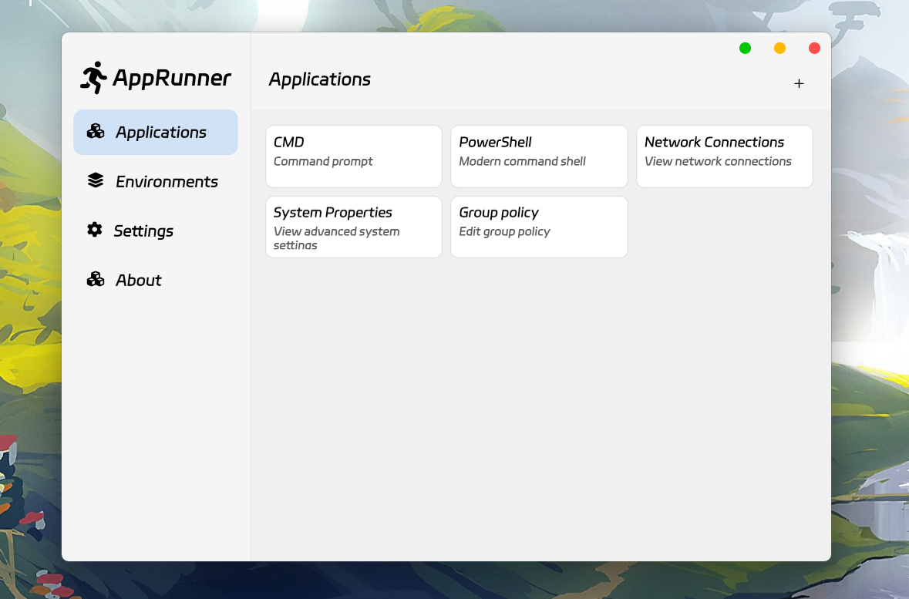

<div align="center">


# AppRunner

_✨ Customize environment variables, file maps, and use them to launch applications on the fly. ✨_
  
</div>


<br/><br/>

## Features

- Customize environment variables.
- Customize file mapping. Make the application actually operate on another specified file when reading or writing a certain file.


## Preview




## Portable build

On Windows with the .NET 8 SDK and Visual Studio C++ desktop build tools installed, publish a self-contained x64 executable with:

```powershell
& 'C:\Program Files\Microsoft Visual Studio\2022\Professional\MSBuild\Current\Bin\MSBuild.exe' AppRunner\AppRunner.csproj /restore /t:Publish /p:Configuration=Release /p:Platform=x64 /p:RuntimeIdentifier=win-x64 /p:SelfContained=true /p:PublishSingleFile=true
```

Use the MSBuild path for your Visual Studio installation (the C++ project builds both x86 and x64 file mapping DLLs). The output is in `AppRunner/bin/x64/Release/net8.0-windows/win-x64/publish/`. Distribute `AppRunner.exe` alone; it creates `data/AppConfiguration.json` beside the exe when settings are saved and extracts the file mapping DLLs to `data/Hookers` when needed. Keep the exe in a writable directory. Existing packaged settings can be brought over using the Settings page's export/import commands.
